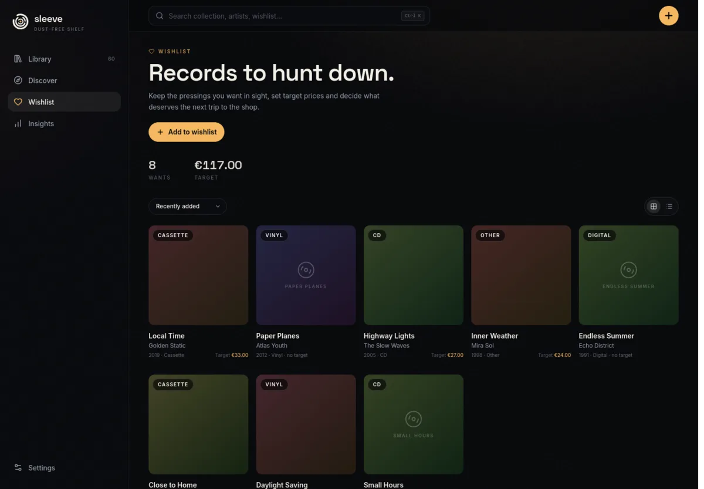
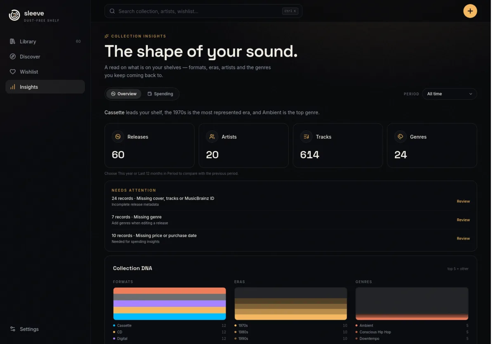

<h1 align="center">
  
  Sleeve
</h1>

<p align="center"><strong>Every record you own, on one dust-free shelf.</strong></p>

<p align="center">
  <a href="https://github.com/Nicuz/sleeve/actions/workflows/ci.yml"></a>
  <a href="https://github.com/Nicuz/sleeve/actions/workflows/pages.yml"></a>
  <a href="LICENSE"></a>
</p>

Sleeve is a digital shelf for your CDs, vinyl and cassettes. Archive what you own, know exactly what is in the collection, and discover the next record through recommendations shaped by your purchases, wishlist and the artists you follow.

<p align="center"><strong><a href="https://nicuz.github.io/sleeve/">Read the docs →</a></strong></p>

<p align="center">
  
  
</p>

## Features

- **Bring your collection over** — import a Discogs CSV or add the first CD, record or cassette.
- **Archive what you own** — pressing, condition, rating, notes and purchase history.
- **Keep a wishlist** — target prices, separate from the shelf and from saved finds.
- **Find the next record** — Discover picks shaped by what you own, rate, wishlist and follow.
- **Read the collection** — formats, eras, genres, spending and records that need attention.
- **Keep it yours** — local SQLite, portable JSON backups and an offline-capable app.

## Look inside

<p align="center">
  
  
</p>

## Quick start

```bash
git clone https://github.com/Nicuz/sleeve.git
cd sleeve
docker compose up -d --build
```

Open **http://127.0.0.1:3001**. Your library lives in the `sleeve-data` volume; back it up from **Settings → Backup & restore**. Update later with `git pull && docker compose up -d --build`.

For login, ports, data layout and upgrades, see [Run on a server](https://nicuz.github.io/sleeve/guide/getting-started#run-it-on-a-server).

<details>
<summary><strong>Run from source</strong></summary>

Requires [Bun](https://bun.sh) 1.4 or newer.

```bash
bun install
cp .env.example .env
bun run db:deploy
bun run dev        # http://localhost:5173
```

Want demo data? Run `bun run sample`, then `DATABASE_URL="file:./sample.db" bun run dev`.

Set a real contact in `MUSICBRAINZ_USER_AGENT` before heavy metadata use.

See [CONTRIBUTING.md](CONTRIBUTING.md) for checks, commit rules and conventions.

</details>

## Docs

- [User guide](https://nicuz.github.io/sleeve/guide/getting-started) — install, add records, import Discogs, wishlist, Discover and backup.
- [Run on a server](https://nicuz.github.io/sleeve/guide/getting-started#run-it-on-a-server) — Docker, optional login and upgrades.
- [Development](https://nicuz.github.io/sleeve/development/) — architecture, API, data model, design, operations and local checks.
- [Architecture](https://nicuz.github.io/sleeve/development/architecture) · [API](https://nicuz.github.io/sleeve/development/api)
- [Contributing](https://nicuz.github.io/sleeve/development/contributing) — checks, commits and conventions.

Docs source lives in `docs/` and builds with VitePress. Local commands are in [Development](docs/development/index.md#docs-site).

## License

MIT — see [LICENSE](LICENSE).
