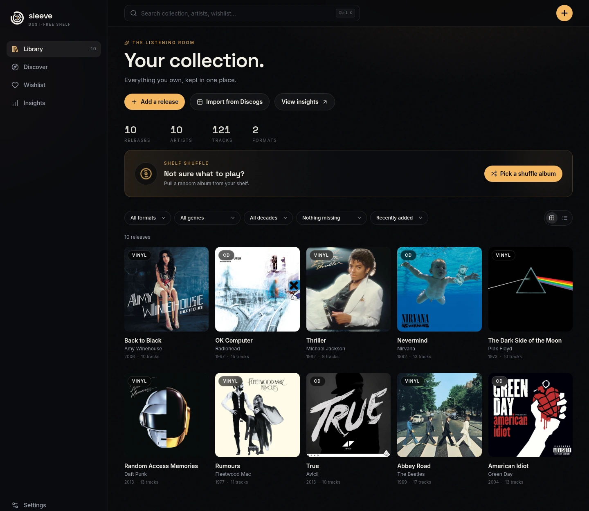
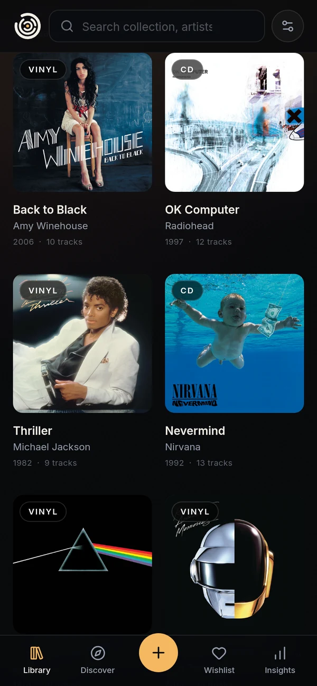

<h1 align="center">
  
  Sleeve
</h1>

<p align="center"><strong>A shelf for the records you chose, and a slower way to decide what to play next.</strong></p>

I started collecting CDs because I wanted to taste music again. I wanted to decide what to listen to based on how I feel, instead of letting shuffle decide for me. I also wanted to own what I really like.

Sleeve is not a replacement for streaming. I still use streaming. This is another way to enjoy music, built around the records I chose.

Sleeve keeps three things in one place: the records you own, the records you are looking for, and a small set of records worth checking next.

<p align="center">
  
  
</p>

## The shelf

Every CD, record and cassette you own, with pressing, condition, rating, notes, purchase date, shop and price. Covers, labels, years and tracklists come from MusicBrainz. Import an existing collection from a CSV. If it already lives on Discogs, its export works as-is.

## The wishlist

Your want list. Records you are looking for, with target prices and notes. Kept separate from the shelf and from Discover saves, so a record you want never counts as one you own.

## Discover

New releases from artists you follow, records by similar artists, and older albums that passed you by. Every card tells you why it appeared. Add it to your wishlist, save it for later, or add it to the shelf. Nothing moves until you choose.

## What it does not do

- It does not play music or replace streaming.
- It does not show marketplace prices or estimate collection value.
- It does not guarantee cover art for every pressing.
- It does not have user accounts. One instance holds one collection.
- It does not add records to your shelf or wishlist on its own.

## Run it

The fastest route is Docker:

```bash
git clone https://github.com/Nicuz/sleeve.git
cd sleeve
docker compose up -d --build
```

Open **http://127.0.0.1:3001**. Your library lives in the `sleeve-data` volume. Back it up from **Settings → Backup & restore**. Update later with `git pull && docker compose up -d --build`.

For login, ports, data layout and upgrades, see [Run on a server](https://nicuz.github.io/sleeve/guide/getting-started#run-it-on-a-server).

<details>
<summary><strong>Run from source</strong></summary>

Requires [Bun](https://bun.sh) 1.4 or newer.

```bash
bun install
cp .env.example .env
bun run db:deploy
bun run dev        # http://localhost:5173
```

Want demo data without touching your own database? Run `bun run sample`, then start against the sample database:

```bash
DATABASE_URL="file:./sample.db" bun run dev
```

`bun run seed` is the other demo path. It adds demo records to your development database instead of a separate file.

Set a real contact in `MUSICBRAINZ_USER_AGENT` before heavy metadata use.

See [CONTRIBUTING.md](CONTRIBUTING.md) for checks, commit rules and conventions.

</details>

## Docs

- [User guide](https://nicuz.github.io/sleeve/guide/getting-started): install, add records, import Discogs, wishlist, Discover and backup.
- [Run on a server](https://nicuz.github.io/sleeve/guide/getting-started#run-it-on-a-server): Docker, optional login and upgrades.
- [Development](https://nicuz.github.io/sleeve/development/): architecture, API, data model, design, operations and local checks.
- [Architecture](https://nicuz.github.io/sleeve/development/architecture) · [API](https://nicuz.github.io/sleeve/development/api)
- [Contributing](https://nicuz.github.io/sleeve/development/contributing): checks, commits and conventions.

Docs source lives in `docs/` and builds with VitePress. Local commands are in [Development](docs/development/index.md#docs-site).

## License

MIT. See [LICENSE](LICENSE).
